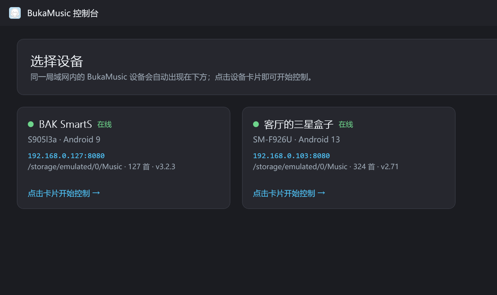
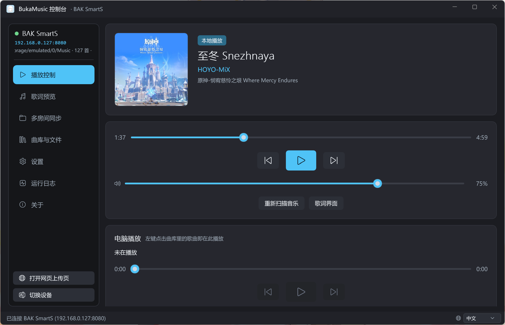
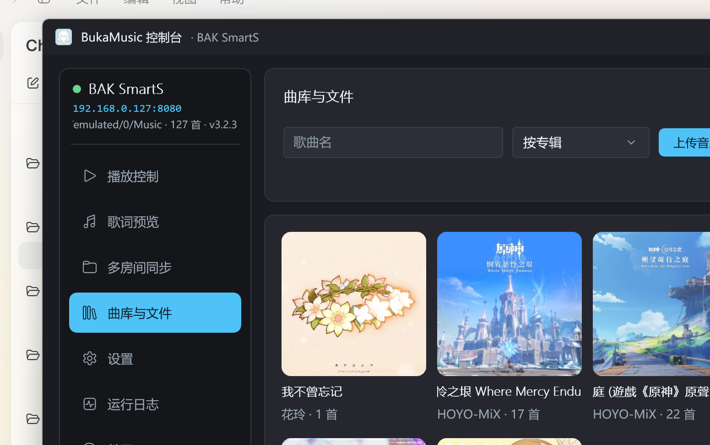
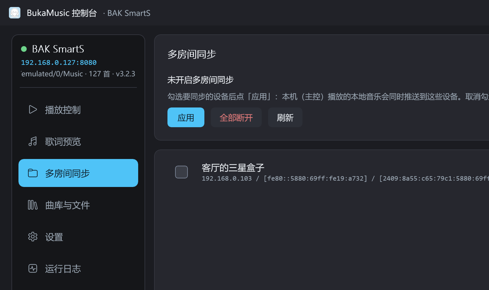
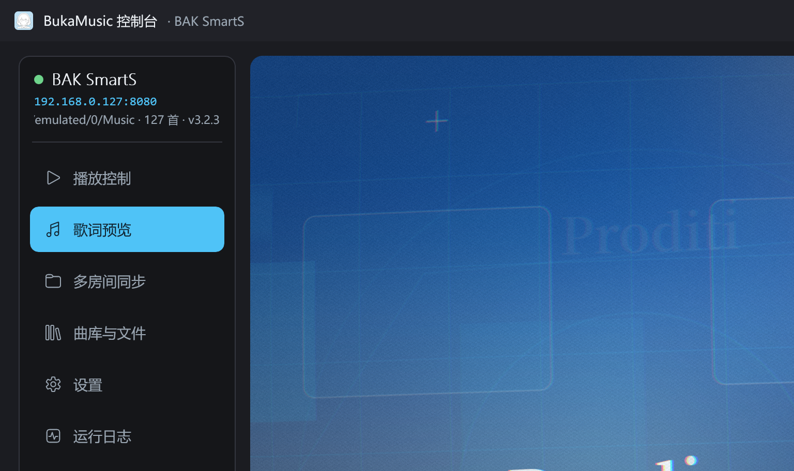
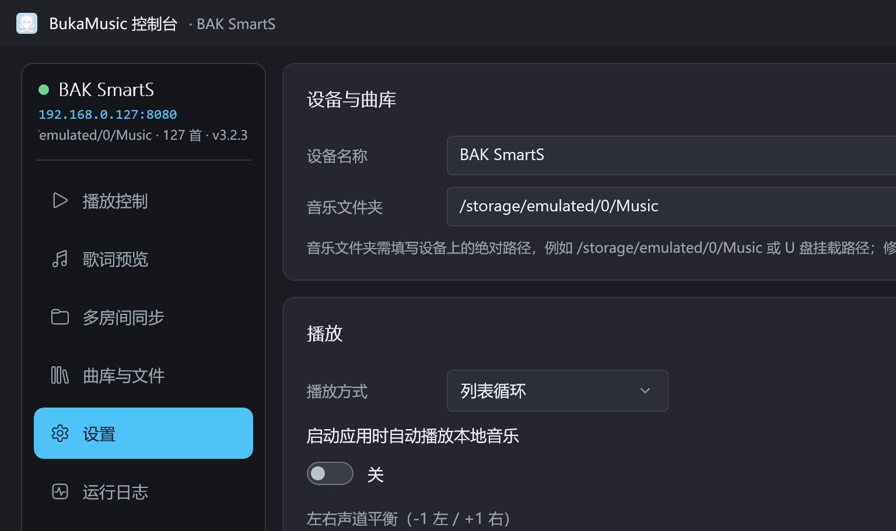

<h1 align="center">BukaMusic Desktop</h1>

<p align="center"></p>

<p align="center">Windows 桌面控制台：自动发现局域网内的 BukaMusic 安卓设备，控制播放、曲库、多房间与歌词</p>

<p align="center">配套安卓端：<a href="https://github.com/HAN-BAK/BukaMusic">HAN-BAK/BukaMusic</a></p>

<p align="center">下载：<a href="https://github.com/HAN-BAK/BukaMusicDesktop/releases">Releases</a>（Windows 10 1809+ / 64 位）</p>

## 功能

### 设备发现



- 自动发现局域网内的 BukaMusic 设备，也可以手动输入 `IP:端口`；
- 每台设备一张卡片，点击进入控制界面；离线设备自动从列表移除。

### 播放控制



- 播放 / 暂停 / 上一曲 / 下一曲、进度拖动、系统音量；
- 电脑本地播放：同一页面下方可直接播放设备上的歌曲，支持拖动进度；
- 远程切换设备界面：打开 / 关闭歌词页；
- 封面、歌名、歌手、专辑与设备实时同步。

### 曲库



- 全部歌曲 / 按专辑 / 按歌手浏览，带封面、搜索与排序；
- 左键在电脑上播放，右键选择在设备上播放；
- 上传音乐、批量删除、重新扫描；
- 管理模式下多选歌曲或整张专辑 / 歌手。

### 网络曲库

- 设置页直接管理设备上的网络音乐路径；
- 支持 WebDAV、SMB（Windows 共享 / NAS）、FTP，可添加多条、填写账号密码；
- 保存后设备自动重新扫描，与本地音乐合并显示。

### 多房间



- 勾选要同步的设备，一键把当前音乐推送到多台设备；
- 接收端只显示「断开多房间连接」；
- 设备状态实时刷新，勾选后立即同步。

### 歌词画面



- 与安卓端一致的商籁（sonnet）歌词渲染（Win2D + 像素着色器）；
- 逐词高亮、间奏三点、镜头位移与光效；
- 双击进入 / 退出全屏，Esc 退出。

### 设置



- 设备名称、音乐路径、播放方式、自动播放、声道平衡、背景模糊；
- 10 段均衡器，可读取 / 保存 / 导入 / 导出设备上的预设；
- 网络曲库、软件更新（启动自动检查 + 手动检查）；
- 中文 / English / 日本語 / 한국어 四语言。

## 使用方法

1. 运行 `BukaMusicSetup.exe` 安装（可选安装目录），或解压便携版直接运行
   `BukaMusicDesktop.exe`。
2. 确保安卓设备与电脑在同一局域网，并在设备上打开 BukaMusic。
3. 启动后会自动列出设备；点击设备卡片进入控制界面。
4. 曲库页左键在电脑播放，右键选择「在 <设备> 上播放」。
5. 多房间页勾选其它设备即可同步播放。
6. 设置 → 检查更新 可手动更新；启动时也会每天自动检查一次。

## 构建方法

环境：.NET 8 SDK、Windows App SDK（NuGet 自动还原）。

```powershell
# 主程序（自包含）
dotnet publish BukaMusicDesktop.csproj -c Release -p:Platform=x64 -p:SelfContained=true -o publish

# 安装程序（单文件）
dotnet publish installer/BukaMusicSetup/BukaMusicSetup.csproj -c Release -o dist/setup
```

产物：

- `publish/BukaMusicDesktop.exe`
- `dist/setup/BukaMusicSetup.exe`
